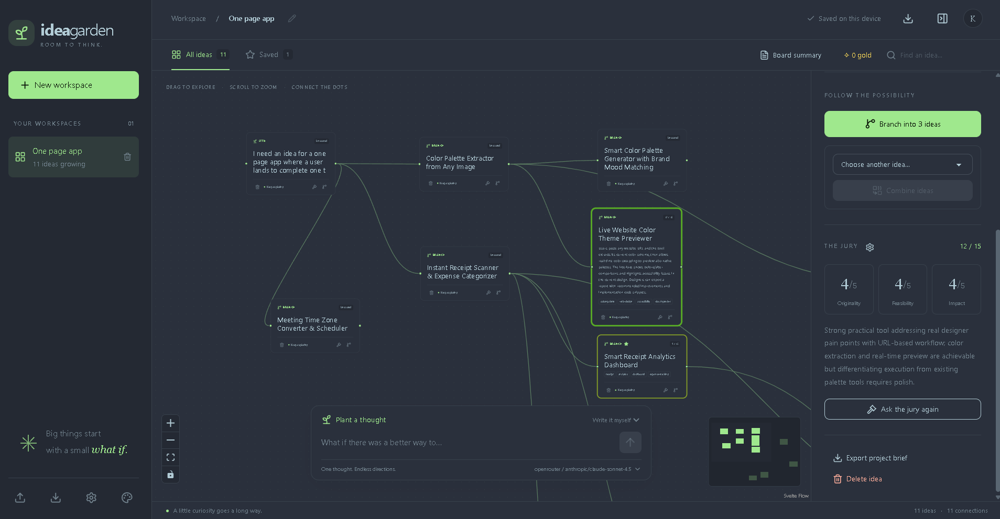

# Idea Garden

Plant a thought, explore its branches, and discover your next project. Idea Garden is a local-first AI brainstorming workspace that turns ideas into an interactive graph. Write your own starting idea or generate one with AI, grow new directions, combine ideas, and let a configurable AI jury help you decide which ones to pursue.  Or give the AI a budget, and let it rip, branching and evaluating on its own, until it finds gold (work in progress)



Built with **SvelteKit 3, Svelte 5, Tailwind CSS 4, DaisyUI 5, and Svelte Flow**

## Features at a glance

- **A visual space to think:** drag, connect, pan, and zoom through your ideas, with a minimap to navigate larger boards.
- **Grow and combine ideas:** create manual or AI seeds, branch an idea into three directions, or combine two ideas into something new.
- **Your own AI jury:** score originality, feasibility, and impact out of 15, with reasoning, keywords, score-colored outlines, and optional automatic evaluation after generation.
- **Choose the right model for each job:** connect OpenRouter, Anthropic, OpenAI, or local Ollama and independently assign Seed, Branch, Cross, Jury, and Summary models with searchable selectors.
- **Make it yours:** theme previews and color swatches, Abyss as the default theme, card font choices, and idea details in a sidebar or modal.
- **Keep ideas organized:** multiple workspaces, goals, inline title editing, search, saved ideas, and deletion confirmations for workspaces.
- **Take your work with you:** AI board summaries, Markdown project briefs, and JSON workspace backups and imports.
- **Local storage and encrypted credentials:** boards stay in your browser; optional password-encrypted API key storage unlocks for each page session.

## Run

Requires Node.js 22.12 or newer.

```sh
npm install
npm run dev
```

Open http://127.0.0.1:4340. For a production build: `npm run build`, then `npm start`.

## Included

- Multiple workspaces, each with a goal; browser persistence and JSON backup/import. First launch starts empty with a Create your first workspace action. Existing saved workspaces load normally.
- Compact header with inline title editing, plus sidebar trash buttons with a confirmation warning before deleting a workspace and its ideas.
- Interactive node graph with dragging, pan, zoom, connections, minimap, and editable idea details.
- Manual seeds or AI distillation; three-way branching and two-parent combinations.
- Card shortcuts: delete on the left, evaluate and branch on the right, with themed hover and keyboard-focus tooltips. Quick AI actions update the board without opening idea details.
- Card descriptions start collapsed. Clicking a card reveals its complete description and opens the selected Sidebar/Modal detail view; choosing another card collapses the previous one. Paragraphs and long text are shown without a line clamp.
- Evaluation colors are enabled by default in Settings: scored cards have red-to-green rings based on their score divided by 15. Unscored cards keep normal outlines, and the toggle is remembered on this device.
- Jury scoring for originality, feasibility and impact, with reasons and keywords. Medals use the reference thresholds: bronze 9, silver 11, gold 13 out of 15.
- Optional **Auto-evaluate** in Settings sends each newly AI-generated seed, branch, or combination to your assigned Jury model as soon as it appears. The preference is saved and starts off. Each new idea adds one evaluation request; failed evaluations leave ideas saved for manual retry.
- Saved ideas, search, AI board summaries, Markdown project brief export.
- OpenRouter, Anthropic, OpenAI and local Ollama; editable model IDs and per-role overrides.
- Separate Settings, Connections, and Models tabs. Settings contains appearance and the persistent Sidebar/Modal idea-view preference; Connections contains provider credentials and the vault; Models contains just the five role assignments. A cog beside The Jury opens and focuses its model selector from either idea view.
- DaisyUI theme switching, with Abyss as the default, plus a light Garden theme and the OhMyPi plum palette.
- Five card font choices with a live preview and a saved preference; Georgia is the default.

No example workspaces or ideas are created automatically. AI generation starts when you click an AI action; enabling Auto-evaluate also runs the jury on its generated ideas. Manual seeds and workspace editing work without keys. Automated browser tests seed their own isolated example data.

## Providers and keys

Open **Settings → Connections** to enter provider keys or configure Ollama's local URL. Then open **Models** to assign a provider and model to Seed, Branch, Cross, Jury, and Summary. There are no separate per-provider model settings on this tab. For Ollama, run Ollama, pull a model (for example `ollama pull qwen3:8b`), and use `http://127.0.0.1:11434`. Only loopback Ollama endpoints are accepted.

Model selectors are searchable dropdowns populated from provider APIs. OpenRouter uses its public text-model catalogue (and sends your key if supplied); Anthropic and OpenAI load with your key; Ollama lists locally installed models. Lists refresh automatically after a key/address change, with a Refresh button for manual updates or server environment keys. Per-role selectors share the loaded lists. Lists stay in memory, not browser storage. If discovery fails, your selection remains intact and **Enter a custom model ID** is always available. OpenAI's list lacks chat-capability metadata, so known non-chat families are filtered, but listing does not guarantee endpoint compatibility or account access.

Custom role assignments use `provider:model`, for example `ollama:qwen3:8b` for the jury and `openrouter:anthropic/claude-sonnet-4.5` for branching. Previously inherited choices are filled from the saved default when Models opens, preserving the models used by existing workspaces. Saved model IDs remain selectable if a provider's catalogue is temporarily unavailable.

The cog beside **THE JURY** opens **Settings → Models**, highlights the Jury model section, and focuses its selector. The jury model affects scoring only; branching keeps its own configured model. Closing Settings returns to the idea modal when opened from that view.

API keys stay in page memory until you choose **Save encrypted keys** in **Settings → Connections → Encrypted key vault**. Choose and confirm a password of at least 12 characters. The vault stores only ciphertext in localStorage, using native Web Crypto AES-256-GCM with a fresh 96-bit IV for each save, a random 128-bit salt, and PBKDF2-SHA256 with 600,000 iterations. The derived encryption key is non-extractable and remains in memory; neither it nor your password is saved. No additional cryptography package is required.

After reopening/reloading the app, a password-only unlock dialog appears when an encrypted vault is saved. Enter your password to restore the keys for this session. Closing the prompt leaves the keys locked; you can unlock later in Connections. No prompt appears when there is no saved vault. The decrypted keys are used from memory for model discovery and generation. You can save changed keys or lock the vault to clear the active keys. There is no password recovery; **Forget encrypted vault** lets you remove it and re-enter your provider keys. Existing plaintext keys from the old remember setting are moved into memory and removed from settings storage when the app loads; save them into the vault before closing the page.

Encryption protects the stored copy while locked; it cannot protect keys from malicious scripts or browser extensions while you type or use them. Choose a strong, unique vault password. Clearing browser storage also clears the vault. Board exports contain neither API keys nor the encrypted vault. The server uses keys only for the current request and does not write them to disk. Environment variables `OPENROUTER_API_KEY`, `ANTHROPIC_API_KEY`, and `OPENAI_API_KEY` remain supported as fallbacks; set them in the shell before starting the app.

The app binds to loopback and has no user authentication. Keep it local. Hosted provider calls may incur charges; there are no autonomous paid loops.

## Scope

This first version implements the core board workflow. Background evolution, live trend/research scouts, cross-board announcements, calibrated jury reference runs, and automatic creation of project folders are not implemented. Project briefs download as Markdown. Boards are saved in this browser rather than a server database; export backups to move them to another browser or machine.


